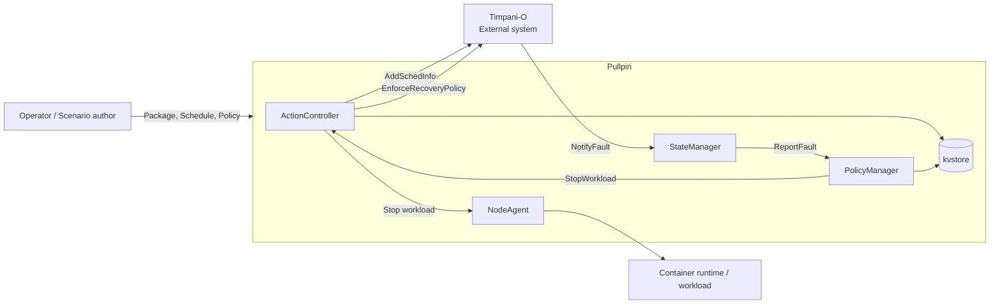
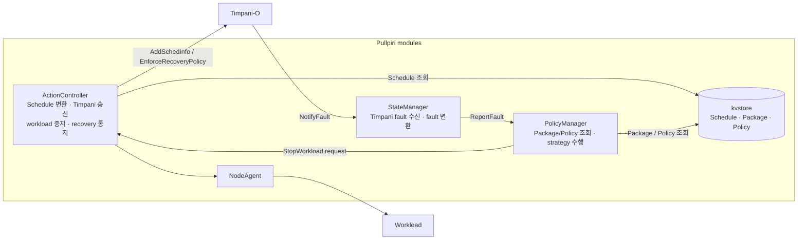
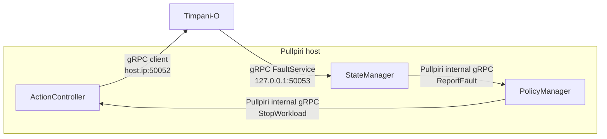
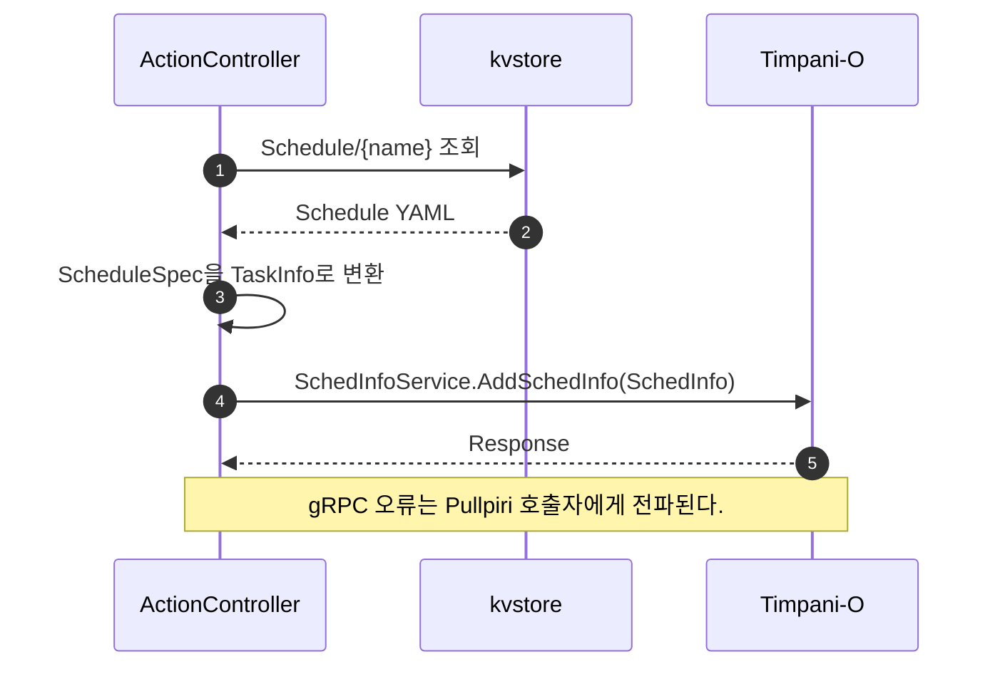
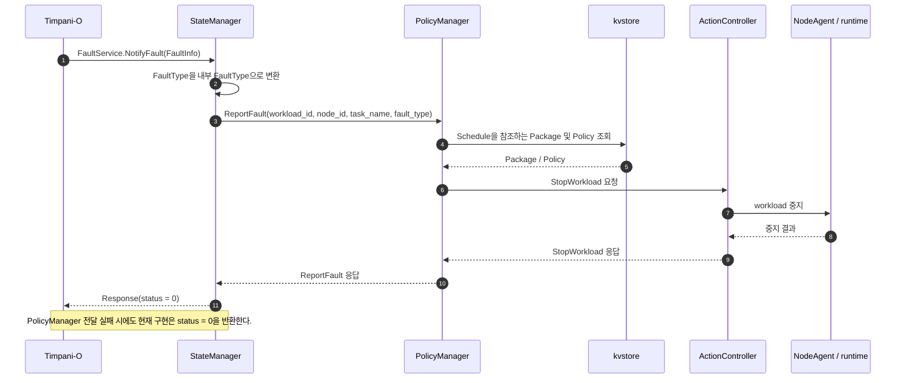
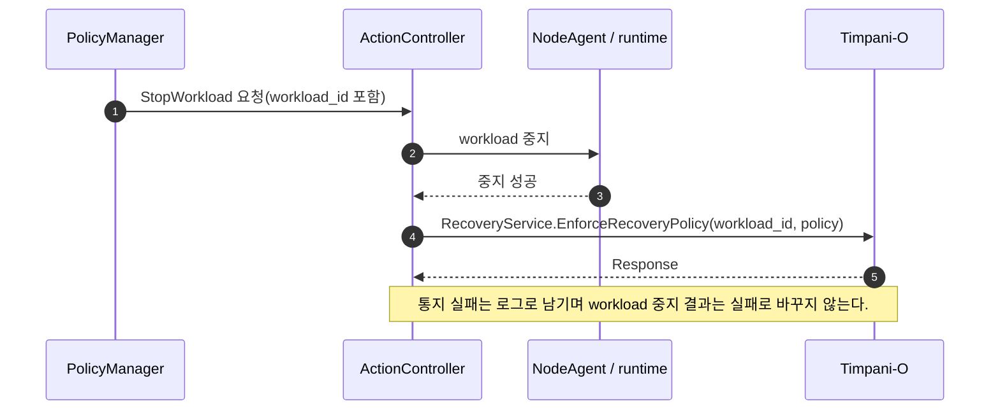

<!--
SPDX-FileCopyrightText: Copyright 2026 LG Electronics Inc.
SPDX-License-Identifier: Apache-2.0
-->
# Pullpiri–Timpani 연동 시스템 설계서

| 항목 | 내용 |
|---|---|
| 문서 상태 | 초안 |
| 문서 유형 | HLD (High-Level Design) |
| 기준일 | 2026-10-22 |
| 범위 | Pullpiri 측 Timpani 연동 및 양 시스템 간 인터페이스 |

> 이 문서는 Pullpiri 저장소의 현재 코드와 프로토콜 정의를 기준으로 작성한다. Timpani 내부 구현 및 양 프로젝트 간 상호운용성은 Timpani 저장소와 실제 배포 환경에서 별도 확인이 필요하다.

## 1. Purpose and Scope

### 1.1 목적

Pullpiri와 Timpani는 독립 프로젝트이며, 실시간 workload의 스케줄 정보와 deadline-miss 기반 fault/recovery 정보를 gRPC로 교환한다. 본 문서는 Pullpiri 코드에 구현된 연동 책임, 컴포넌트 구조, 인터페이스와 주요 데이터 흐름을 설명한다.

### 1.2 범위

- Schedule 리소스를 Timpani `SchedInfo`로 변환하고 등록하는 흐름
- Timpani fault를 Pullpiri 정책 처리로 전달하고 workload 중지를 요청하는 흐름
- workload 중지 성공 후 Timpani에 recovery policy를 통지하는 흐름
- Pullpiri 측 gRPC 계약, 데이터 매핑, 네트워크 설정 및 오류 처리

Timpani의 내부 스케줄러 구현, deadline-miss 감지 알고리즘, Timpani의 서비스 배포 구성은 이 문서의 범위에 포함하지 않는다.

## 2. Functional Requirements

| ID | 요구사항 |
|---|---|
| FR-01 | Pullpiri는 Schedule 리소스의 task 정보를 Timpani `SchedInfo`로 변환하여 등록해야 한다. |
| FR-02 | Pullpiri는 Timpani로부터 수신한 fault의 workload, node, task 및 fault type 정보를 정책 처리 경로로 전달해야 한다. |
| FR-03 | Pullpiri는 fault 유형과 workload에 적용된 정책에 따라 적절한 workload 대응 동작을 수행해야 한다. |
| FR-04 | Pullpiri는 fault 대응 동작의 종류와 결과를 Timpani와 연계할 수 있어야 한다. |

## 3. System Context

Pullpiri는 workload lifecycle과 정책 적용을 관리하고, Timpani는 실시간 스케줄 정보를 수신하고 fault/recovery 통지를 교환하는 외부 시스템으로 취급한다.

## 4. Architecture Views

### 4.1 Module View

아래 다이어그램은 Pullpiri 코드에서 확인되는 모듈 책임과 의존 관계를 나타낸다. Timpani는 별도 프로젝트이므로 내부 모듈은 상세화하지 않고 시스템 경계로 표시한다.

### 4.2 C&C View

C&C(Connection and Connector) view는 실행 시 통신 경계를 나타낸다. Timpani endpoint와 Pullpiri fault receiver의 주소는 현재 코드의 설정이며, 컨테이너/호스트 네트워크에서 실제로 도달 가능한지는 배포 구성을 기준으로 확인해야 한다.

## 5. API, Interface, and Data Flow

### 5.1 gRPC API

서비스와 메시지 정의는 Appendix의 인터페이스 원본 링크를 참조한다.

| RPC | 방향 | 요청 주요 필드 | Pullpiri 동작 |
|---|---|---|---|
| `SchedInfoService.AddSchedInfo` | Pullpiri → Timpani | `workload_id`, `tasks[]`, `temporal_class` | Schedule을 Timpani 메시지로 변환해 전송한다. |
| `FaultService.NotifyFault` | Timpani → Pullpiri | `workload_id`, `node_id`, `task_name`, `type`, `cumulative_dmiss` | StateManager가 fault type을 변환해 PolicyManager에 전달한다. `cumulative_dmiss`는 내부 요청에 전달하지 않는다. |
| `RecoveryService.EnforceRecoveryPolicy` | Pullpiri → Timpani | `workload_id`, `recovery_policy` | workload 중지 성공 후 적용한 recovery policy를 통지한다. |

세 RPC는 공통 `Response.status`를 사용하며 proto 주석은 `0`을 성공, non-zero를 오류로 정의한다. 현재 Pullpiri 송신 코드는 gRPC transport 성공 여부를 확인하고 응답의 `status` 값은 별도로 판정하지 않는다.

### 5.2 Schedule 데이터 매핑

| Pullpiri Schedule | Timpani `SchedInfo` / `TaskInfo` | 비고 |
|---|---|---|
| Schedule metadata name | `workload_id` | PolicyManager도 이 값을 Schedule 이름으로 사용한다. |
| `spec[].name` | `tasks[].name` | Task 식별자 |
| `priority`, `policy`, `cpu_affinity` | 같은 이름의 TaskInfo 필드 | `NORMAL/FIFO/RR`를 정수 enum 값으로 변환한다. |
| `period`, `release_time`, `runtime`, `deadline` | 같은 이름의 TaskInfo 필드 | 단위는 proto 주석상 마이크로초(us)다. |
| `node_id`, `max_dmiss` | 같은 이름의 TaskInfo 필드 | deadline-miss 기준 전달에 사용된다. |
| Schedule `temporal_class` | `SchedInfo.temporal_class` | `PERIODIC=0`, `SPORADIC=1`; 미설정 시 Pullpiri 기본값은 PERIODIC이다. |

### 5.3 Schedule 등록 흐름

### 5.4 Deadline-miss 처리 흐름

### 5.5 Recovery 통지 흐름

## 6. Failure Handling

### 6.1 오류 처리

| 상황 | 현재 Pullpiri 동작 |
|---|---|
| Schedule 등록의 gRPC 연결/호출 오류 | ActionController의 Schedule 처리에서 오류를 반환한다. |
| PolicyManager의 fault 처리 실패 | StateManager가 오류를 기록하지만 Timpani에는 `Response(status = 0)`을 반환한다. 재시도 동작은 이 경로에서 확인되지 않는다. |
| workload 중지 실패 | ActionController의 StopWorkload 실패 응답이 PolicyManager로 전달된다. 복구 통지는 수행하지 않는다. |
| Recovery 통지 실패 | ActionController가 오류를 기록하고 중지 작업의 성공 응답은 유지한다. |
| RPC 응답의 non-zero `Response.status` | 현재 Pullpiri sender는 transport 성공과 분리해 이 값을 오류로 처리하지 않는다. |

## 7. Future Work

현재 PolicyManager의 fault 대응은 `stop` strategy를 중심으로 동작한다. 향후에는 공통의 workload action 처리 흐름을 마련하여 다음 동작을 지원하는 방향으로 확장할 수 있다. 아래 설명은 기능 범위를 구체화하기 위한 초안이며, 각 동작의 상태 전이와 Timpani 인터페이스는 양 프로젝트 간 합의가 필요하다.

| 동작 | 설명 |
|---|---|
| `start` | 정지 상태의 workload를 Package 및 실행 설정에 따라 시작한다. 시작 결과와 필요한 스케줄 정보를 Timpani와 동기화한다. |
| `stop` | 실행 중인 workload를 정상 종료 절차에 따라 정지하고, 성공/실패 결과를 반환한다. 기존 대응 동작을 공통 action 모델에 포함해 다른 동작과 일관된 결과·오류 처리를 제공한다. |
| `restart` | workload를 정지한 뒤 다시 시작한다. 두 단계 중 어느 단계에서 실패했는지 식별할 수 있도록 결과를 관리하고, 재시작 후 스케줄 정보를 Timpani와 재동기화한다. |
| `notify` | workload lifecycle을 변경하지 않고 fault, 정책 판단 또는 대응 결과를 관련 시스템에 통지한다. 통지 대상, 전달 보장 수준, 중복 처리 방식은 별도 정의가 필요하다. |

## Appendix. Interface Definition

- [Timpani gRPC Protocol (`schedinfo.v1.proto`)](../../../../src/common/proto/external/timpani/schedinfo.proto)
